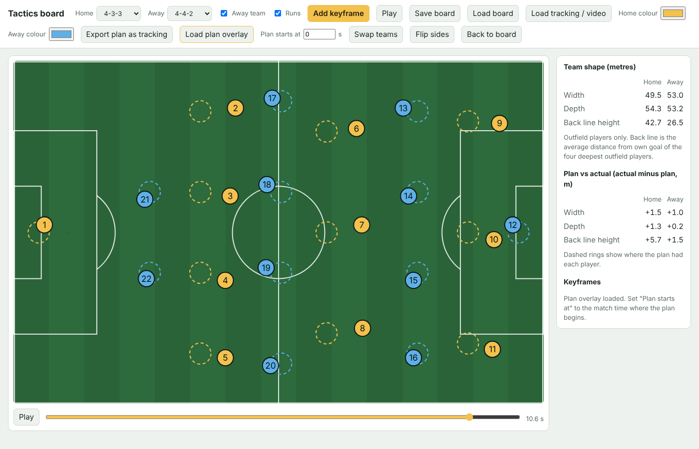
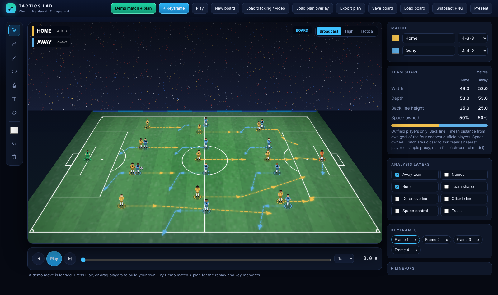
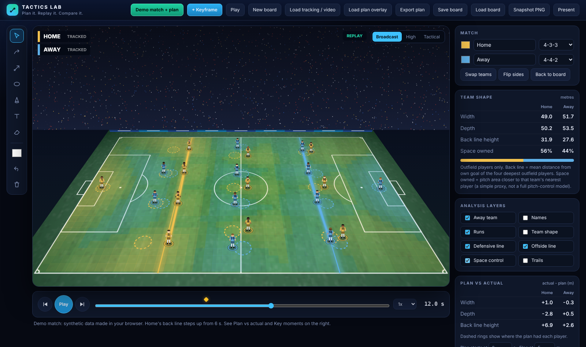
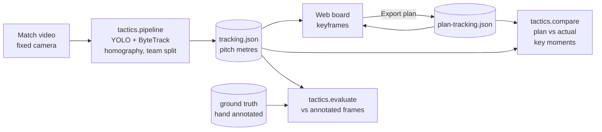

# Football tactics board with video-based match analysis

Final-year Production Project, BSc Computer Science, Leeds Beckett University (2026/27).

A web tactics board where a coach plans formations and pressing as animated keyframes, then compares that plan with what actually happened in a match. A computer-vision pipeline turns fixed-camera footage into 2D pitch positions, and an analysis layer flags where tracked play departed from the plan, with the evidence for each flag.



*Synthetic demo data. Dashed rings are the plan; solid players are the "tracked" positions; the panel shows actual minus plan in metres.*

## The board

`web/index.html` is a single-file analysis board in a broadcast style: draw runs, pass lines, zones, labels and player spotlights; overlay team shape, defensive line, offside line, space control and movement trails; replay tracked matches beside the video; compare against a plan, with key moments flagged and clickable on the timeline. Three camera views (Broadcast, High, Tactical), presentation mode and PNG snapshot are built in. A demo move plays on open, and "Demo match + plan" loads a synthetic replay with key moments. Shortcuts: V move, R run, P pass, Z zone, S spotlight, T label, E eraser, K keyframe, Space play, arrows step, Ctrl+Z undo.




"Space owned" is the share of pitch closer to each team's nearest player. It is a simple proxy and is not the published pitch-control model.

## 3D stadium mode (new)

Open `web/index.html` (double-click works, no server needed). The board starts in the 3D stadium; use the 3D / 2D switch to change.

- Cameras: Broadcast, Sideline, End, High, Tactical, Orbit, Follow, Drone. Right-drag or Shift-drag to orbit, wheel to zoom, `C` cycles cameras.
- Ball: Ground / Lofted / Driven flight, curved paths (Draw Curve tool, `B`), ball carrier, and kick animations (pass, shot, header, throw-in). Select a keyframe first; these apply to the segment that follows it.
- Players: run, idle, goalkeeper and kick animation. Click a player for a profile (name, position, age, height, foot, nationality, notes, photo).
- Playback speed 0.1x to 4x (`[` and `]`).
- Set pieces: corners, throw-ins, free kicks, goal kicks and penalties, built as phase keyframes for either team and side.
- Heatmaps (all / one player, home / away / ball) and shot lines (`H`).
- Team sizes 3v3 up to 11v11 with a marked play area for small-sided games.

- Match events: yellow and red cards (a second yellow becomes red), goals, assists, subbed off, injured. Red cards and subs take the player off the pitch.
- Help / tutorial button (or `?`) explains every feature; Reset all clears the board, names, profiles, cards, layers and settings.

Files: `web/stage3d.js` (Three.js scene), `web/motion.js` (ball physics, set pieces, heatmap maths; tested in Node), `web/vendor/three.min.js` (r128).

## The problem

Amateur and university teams plan tactics on whiteboards and review matches by re-watching video. Professional analytics platforms do much more but are costly and closed. There is little low-cost tooling that connects a coach's plan to what actually happened. This project builds that link and, importantly, **measures how well it works**: tracking accuracy against hand annotation, agreement with coaches' judgement of key moments, and usability. See [docs/RESEARCH.md](docs/RESEARCH.md).

## What works today

| Capability | Status |
|---|---|
| Drag-and-drop board, 4 formation presets, keyframe animation, run arrows | Done, browser-tested |
| Live team-shape metrics (width, depth, back-line height) | Done, same definition in JS and Python |
| Replay of `tracking.json` and synchronised MP4 | Done |
| Plan overlay and plan-vs-actual deviation panel | Done, browser-tested |
| Key-moment flags with evidence sentences (`tactics.compare`) | Done, unit-tested |
| Tracking accuracy evaluator (`tactics.evaluate`) | Done, unit-tested |
| Video pipeline (YOLO + ByteTrack, homography, kit-colour teams) | Written; **not yet validated on real footage** |
| Annotation helper for ground truth | Not started (next priority) |
| Expert validation and usability study | Waiting on ethics approval |

Nothing in `data/` is real tracking output. It is synthetic, generated by `scripts/make_sample_data.py`.

## Quick start (Windows, PowerShell)

```powershell
git clone https://github.com/Nk7650/Final-year-project-football-whiteboard.git
cd Final-year-project-football-whiteboard
py -3.12 -m venv .venv
.\.venv\Scripts\Activate.ps1
pip install -r requirements.txt
```

**Board:** open `web/index.html` in Chrome or Edge (no server needed). Click **Load tracking / video** and choose `data/sample-tracking.json`, then **Load plan overlay** and choose `data/sample-plan.json`.

**Plan vs actual report:**

```powershell
python -m tactics.compare data/sample-plan.json data/sample-tracking.json --team 0 --metric back_line --threshold 4 --min-duration 1.5
```

**Video to tracking** (only with footage you are allowed to use; see [docs/ETHICS.md](docs/ETHICS.md)):

```powershell
python -m tactics.pipeline clip.mp4 --box left --every 5 --out tracking.json
python -m tactics.export tracking.json        # readable .txt and .csv for the report
```

**Accuracy against annotated frames:**

```powershell
python -m tactics.evaluate tracking.json ground_truth.json --gate 2.0 --json results.json
```

## Tests

```powershell
pip install -r requirements-ci.txt
python -m pytest -q
```

39 tests. The browser smoke tests need `pip install playwright` and a Chrome binary (`CHROME_PATH`); they skip themselves otherwise. CI runs everything else on every push.

## Architecture in one picture



Details, data contract and design decisions: [docs/ARCHITECTURE.md](docs/ARCHITECTURE.md).

## Repository map

```
web/index.html          single-file board (canvas, no build step)
tactics/                Python package: geometry, trackdata, pipeline, metrics, compare, evaluate, export
tests/                  pytest suite incl. headless-browser smoke tests
data/                   synthetic demo files (not real results)
scripts/                reproducible sample-data generator
docs/                   research, architecture, evaluation, ethics, roadmap, WIP pack, project log, AI use
```

## Limitations (read before trusting any number)

- Fixed, wide tactical-camera footage only. Broadcast footage with panning is out of scope.
- The "goalkeeper" is assumed to be each team's deepest player, and team 0 is assumed to defend the left goal. Use **Flip sides** and **Swap teams** on the board if calibration disagrees.
- Referees and substitutes can be assigned to a team by the colour clustering.
- Identity switches are not yet measured, so MOTA and IDF1 are not reported.
- Professional benchmarks may not suit amateur footage, which is why plan-versus-actual comparisons come first. See [docs/RESEARCH.md](docs/RESEARCH.md).

## Data, ethics and AI use

No footage, model weights or participant data are stored in this repository. Ethics status and rules: [docs/ETHICS.md](docs/ETHICS.md). Generative AI use is declared in [docs/AI_USE.md](docs/AI_USE.md). Open datasets (StatsBomb, SoccerNet, Metrica) must be credited and used under their licences. No licence has been chosen for this repository yet, so all rights are reserved by default.
