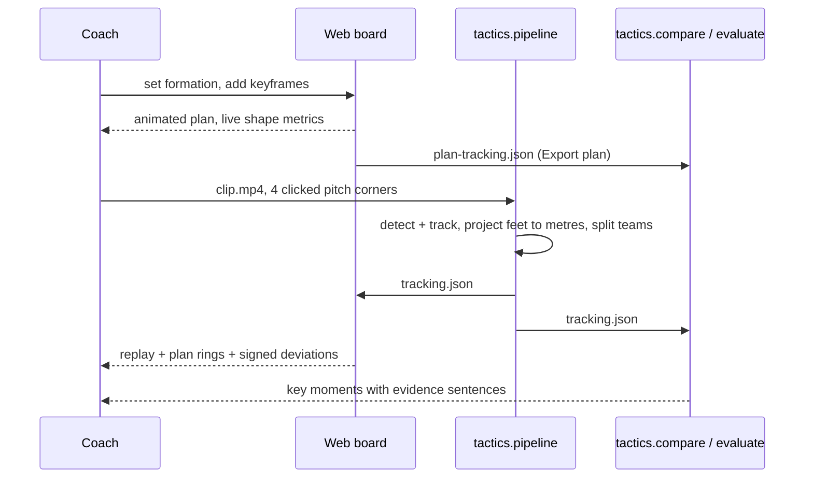

# Architecture

## Components

| Component | Where | Responsibility |
|---|---|---|
| Web board | `web/index.html` | Plan tactics (keyframes), replay tracked play, overlay the plan, show shape metrics and deviations |
| Pipeline | `tactics/pipeline.py` | Video to per-frame pitch positions (detect, track, calibrate, project, split teams) |
| Geometry | `tactics/geometry.py` | Homography (normalised DLT), pitch landmarks, on-pitch test, 180 degree flip |
| Track assembly | `tactics/trackdata.py` | Kit-colour team clustering, builds and saves the `tracking.json` contract |
| Metrics | `tactics/metrics.py` | Team shape, plan-vs-actual deviation, key-moment detection, contract validation |
| Compare CLI | `tactics/compare.py` | Markdown report of deviations and flagged moments |
| Evaluator | `tactics/evaluate.py` | Precision, recall, position error and team accuracy against annotated frames |
| Export | `tactics/export.py` | `tracking.json` to readable text and CSV for the report |

## Data flow



## Coordinate system

All positions are metres on a 105 x 68 pitch: `x` runs 0 (left goal line) to 105, `y` runs 0 (top touchline) to 68. Team 0 defends the left goal and team 1 the right. The board, the pipeline and every analysis tool use this one system, so a file produced by any of them can be loaded by any other.

## Data contract: `tracking.json`

```json
{ "fps": 5.0,
  "frames": [ { "t": 0.0, "players": [ { "id": 3, "team": 0, "x": 12.3, "y": 40.1 } ] } ] }
```

- `t` is seconds and never decreases; `fps` is the sampling rate (video fps divided by `--every`).
- `team` is 0 or 1. Colours are arbitrary, so tools never assume team 0 is "home" in the real match.
- `id` is a tracker id and is not stable across long occlusions.
- The same format is used for plans (exported from the board) and for ground truth (annotated frames only).
- `tactics.metrics.validate_tracking` enforces this and gives a readable error. Run the tests to see the rules in executable form.

## Design decisions

**1. Tracking runs offline in Python; the browser only replays.** Detection and calibration in the browser would be less accurate and harder to reproduce. The evaluation needs a repeatable process with fixed settings, which a script provides.

**2. The board is one HTML file with no build step.** A student can open it by double-clicking, and a supervisor can run it without installing anything. The cost is a long file; if it grows much further it should be split into modules.

**3. One definition of every metric, in two languages, tested for parity.** `shape()` in the board and `team_shape()` in Python share the same rules (goalkeeper excluded, back line is the mean of the four deepest outfield players). Both are tested against the same hand-computed numbers (width 48, depth 53, back line 25 for a 4-3-3), so the board and the written reports cannot disagree silently.

**4. Homography is implemented in numpy (normalised DLT) rather than by calling OpenCV.** It is the same maths for four points, but it can be unit-tested without OpenCV, supports more than four points by least squares, and provides a reprojection error in metres for validating a calibration (not yet wired into the evaluator).

**5. Suggestions are evidence, not verdicts.** The first layer (plan versus actual) uses the coach's own plan as the standard, so each flag can be checked against the video. Benchmarks from professional data come later and are shown as percentiles with sample sizes. See [RESEARCH.md](RESEARCH.md).

**6. Team labels are stable but arbitrary.** The lowest track id is always team 0, so rerunning on the same clip gives the same colours. The evaluator scores the better of "as is" and "swapped" for the same reason.

**7. Validate at the boundary.** Every loader checks the contract and fails with a clear message. A malformed file should never silently produce plausible-looking numbers.

## Known limitations and failure modes

| Limitation | Effect | Mitigation |
|---|---|---|
| Needs a penalty area in view for calibration | Clip unusable otherwise | Landmark set is a small function; more landmarks can be added |
| Feet point assumed to be the bottom of the box | Error grows for players at the far edge | Report error in metres on annotated frames |
| Goalkeeper = deepest player | Wrong when a team has no keeper in view or defends high | Documented; board shows the numbers used |
| Referees and substitutes can be clustered as players | Skews shape metrics | On-pitch filter; manual correction is a planned feature |
| No identity-switch metric yet | Cannot report MOTA or IDF1 | Needs ID-consistent ground truth |
| Camera must be fixed | Broadcast footage out of scope | Declared in the specification (Won't have) |
| `ultralytics` is AGPL-licensed | May matter if the code is distributed | Cite the licence; check with the supervisor |

## Testing strategy

- **Unit tests** for the maths and data handling, using synthetic formations whose answers can be computed by hand.
- **Property-style checks**: a known camera transform must be recovered exactly from four points and tolerate about one pixel of click noise with extra points.
- **Browser smoke tests** (Playwright, headless Chrome) drive the real page: animation advances between keyframes, tracking replay updates metrics, the plan overlay shows signed deviations, and a wrong time offset is explained rather than shown blank.
- **CI** runs the suite on every push and checks the sample data regenerates byte for byte.
- **Not tested yet:** the pipeline on real video. That is the next validation step and the results will be recorded in [EVALUATION.md](EVALUATION.md).
